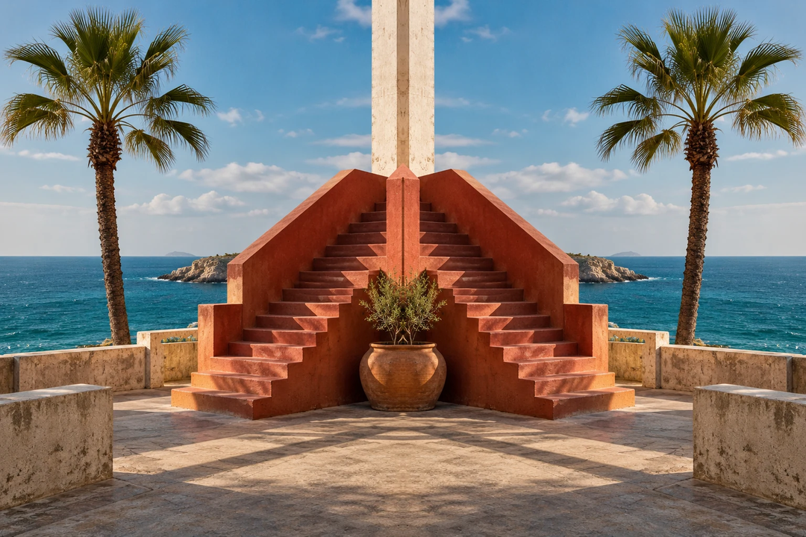
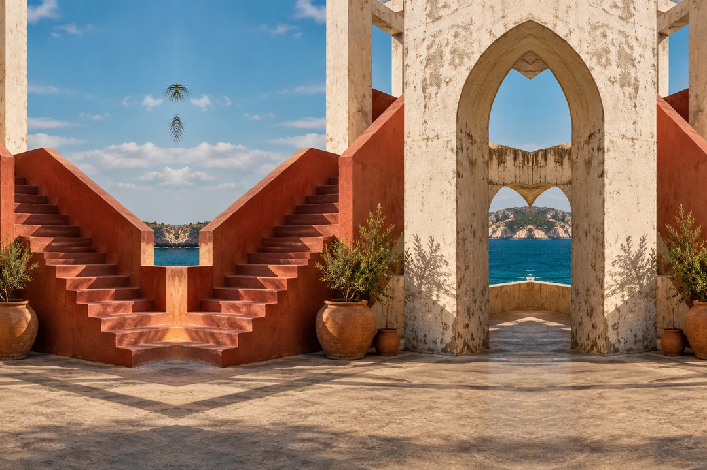
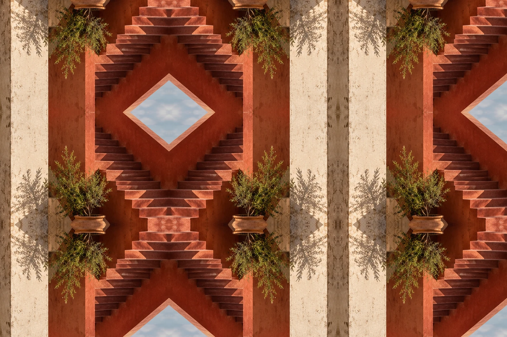

# Mirror Worlds

**See the reflections live. Take the photo. Keep it in RAW.**

Mirror Worlds adds creative mirror effects to your camera. Make impossible buildings, invent a second horizon, or surround your subject with reflections. Compose in LiveView and press the **normal shutter button**: the mirror is already in your **Canon CR2 RAW photo**.

**Developed on and tested on the original Canon EOS M.** Made by **Max Seelig (MAXmade)**.

[**Visit the website & try a mirror**](https://mirror-worlds.netlify.app/) · [**Download 0.2.0**](https://github.com/m-a-x-s-e-e-l-i-g/mirror-worlds/releases/download/v0.2.0/MIRROR-0.2.0-EOSM202.zip) · [Start shooting](#start-shooting) · [Camera compatibility](#will-it-work-with-my-camera)

*Right · Half. These examples use the website’s mirror renderer and an AI-generated starting scene; they are illustrations, not photos captured with the module. Mirror Worlds itself uses no AI.*

## What can it do?

- **Mirror one edge:** left, right, top or bottom.
- **Mirror both sides:** left + right, or top + bottom.
- **Surround the scene:** reflect all four edges, including the corners.
- **Choose how much:** half, third, quarter, fifth or sixth of the picture.
- **Keep shooting normally:** physical shutter, Canon RAW, camera review and playback.
- **Pick up where you left off:** ON/OFF, placement and sizes are remembered after restart.

No separate test action. No saving photos from a menu. No TIFF or DNG conversion. Canon autofocus and Auto ISO continue to work.

## Will it work with my camera?

The supported, tested starting point is:

| You need | Tested setup |
|---|---|
| Camera | **Original Canon EOS M** |
| Canon firmware | **2.0.2** |
| Magic Lantern | **Dev build 2025-06-20 / EOSM.202** |
| Shooting | **A+ · Auto ISO · Canon RAW · single-shot drive** |
| LiveView | **Native 1× view · Global Draw ON** |

**Other cameras and other EOS M models have not been validated.** This is not a general module for every Magic Lantern camera. Other ML builds are also unverified.

Magic Lantern must already be installed. Mirror Worlds is an add-on module; the download does **not** replace your Canon firmware or Magic Lantern core. If you are new to Magic Lantern, start with the [official EOS M page](https://builds.magiclantern.fm/EOSM.html).

## Start shooting

1. **Download and unzip [Mirror Worlds 0.2.0](https://github.com/m-a-x-s-e-e-l-i-g/mirror-worlds/releases/tag/v0.2.0).** You do not need to compile anything.
2. **Power the camera OFF.** Copy `mirror.mo` from the ZIP’s `ML/MODULES` folder into `ML/MODULES` on your card.
3. Put the card back. In Magic Lantern’s **Modules** tab, enable **mirror.mo**, then **restart the camera**. Leave older glock and other MAXmade effects disabled.
4. Use the tested setup above. Open **Shoot → Mirror Worlds** and its controls submenu. Turn **Live effect ON**.
5. Choose **Mirror on**, **Width** and **Height**. Close the menu, compose your photo and press the **physical shutter**. Release it between photos.

That’s it. Canon saves the mirrored CR2 and handles immediate review and Play/gallery. Capture rearms automatically for the next single shot. Your last settings, including ON/OFF, return after restart.

## A few starting ideas

| Try this | What happens |
|---|---|
| **Right · Half** | Keep the left half; reflect it into the right half. |
| **Left · Half** | Keep the right half; reflect it into the left. |
| **Bottom · Third** | The bottom third reflects the neighbouring scene above it. |
| **Left + Right · Quarter** | Keep the central half, with mirrored outer quarters. |
| **All edges · Quarter / Quarter** | Keep a central rectangle surrounded by reflections; corners reflect both ways. |

**Width and Height describe each mirrored border.** Width is unused for top/bottom-only layouts; Height is unused for left/right-only layouts.

Opposing edges start at **Third**: two half-size borders would leave no original center to reflect. Switching to an opposing layout automatically adjusts an existing Half to Third. Nothing is resized.

All **44 usable combinations** are in the same build. Change settings and shoot—no intermediate builds or diagnostic logging steps.

| Left + Right · Quarter | Bottom · Third | All edges · Third / Third |
|---|---|---|
|  |  |  |

*One scene, three more folds. [Try the layouts on the website](https://mirror-worlds.netlify.app/#try), or choose your own photo in the playground.*

## Good to know

- This release is for **single RAW photos**. Bursts, video, remote triggers and long exposures are outside its supported workflow.
- More mirrored area may take longer to process. Allow the camera to finish before the next shot.
- The module does not create a companion original. Turn the effect OFF to take ordinary photos.
- If a capture is rejected by the safeguards, that photo can remain unmirrored. Try **Live effect OFF/ON**, or restart.
- If the effect will not start, check your versions, **1× LiveView**, **Global Draw**, and other active effects.
- Settings save automatically into two small preference files in ML’s current settings directory. No manual save or log collection is needed.
- To uninstall, **power OFF** and remove `ML/MODULES/mirror.mo`. Do not replace or dynamically unload it while it is running.

[More usage details](docs/usage.md) · [Report a problem](https://github.com/m-a-x-s-e-e-l-i-g/mirror-worlds/issues)

## The project

**0.2.0 is the first public release of this standalone repository.** It contains the same module and ZIP accepted during development; the publication does not rebuild or change the camera binary.

The [Mirror Worlds website](https://mirror-worlds.netlify.app/) is live on Netlify, with an interactive mirror playground, examples, clear compatibility notes and installation instructions. See the [website guide](docs/website.md) for local previews and deployment settings. The site has no build dependencies and works as a static page.

For people who want to look inside: [building the module](docs/development.md), [release notes](docs/release-0.2.0.md) and [checksums](downloads/SHA256SUMS).

Mirror Worlds is free software under **GPL-2.0-or-later**. See [COPYING](COPYING) and [credits](NOTICE.md).
